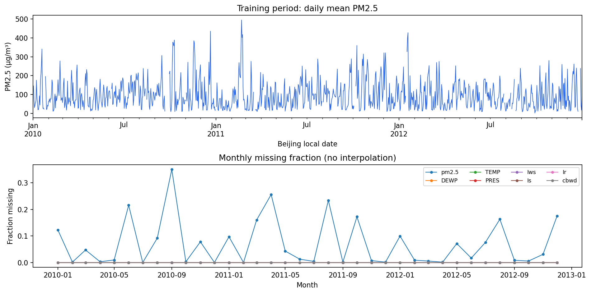
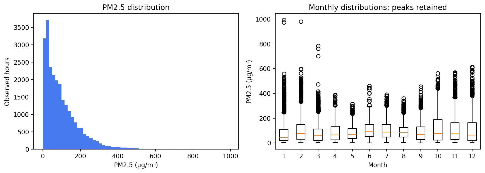
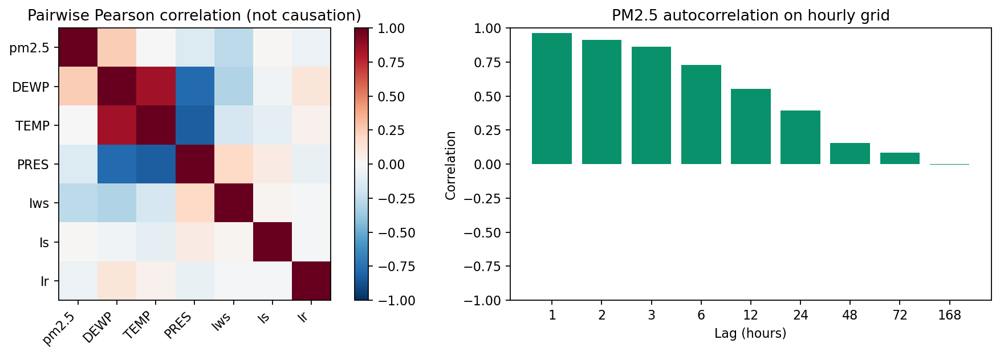
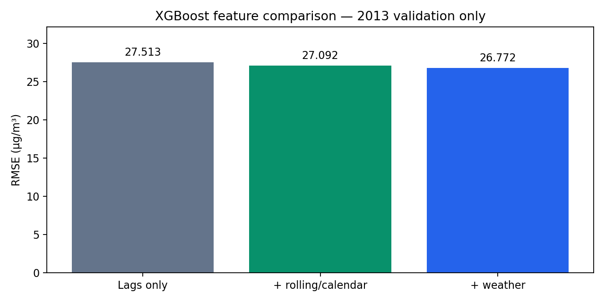
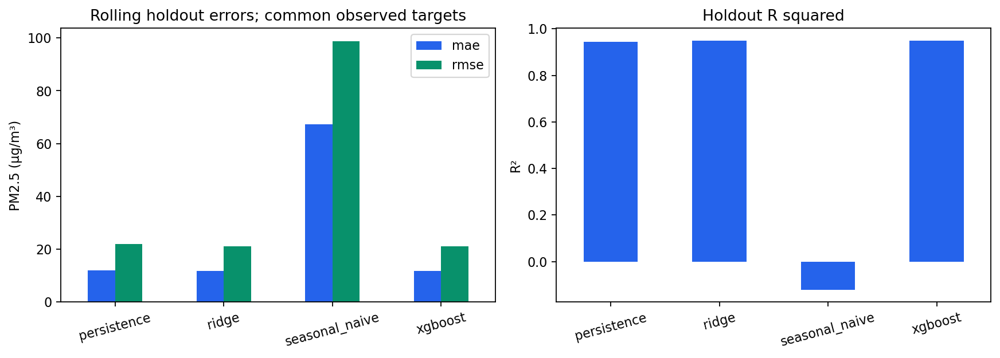
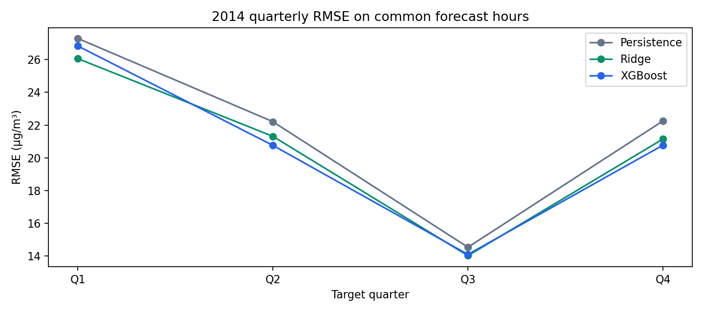
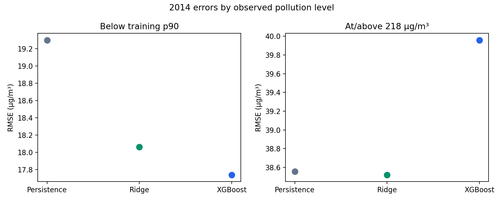
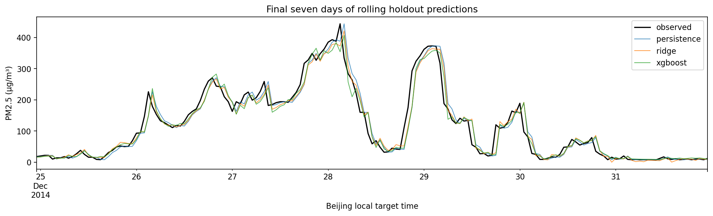

# What we found in the Beijing data

This analysis uses the supplied `PRSA_data_2010.1.1-2014.12.31.csv`. We kept the original experiment settings: a one-hour forecast, initial training on 2010–2012, parameter selection on 2013, and four expanding quarterly backtests in 2014. All concentrations and absolute errors below are in µg/m³.

## Cleaning: preserve the clock and the measurements

The file contains 43,824 rows, covering every hour from 1 January 2010 to 31 December 2014. The timestamps are already sorted and unique. No hourly rows needed to be inserted. The date fields and numeric measurements passed validation; PM2.5, accumulated wind speed, and the precipitation-duration fields have no negative observed values.

PM2.5 has 2,067 missing readings, or 4.72% of the archive. The weather fields are complete. These are missing measurements within an otherwise complete timestamp grid. There are 214 separate PM2.5 gaps; the longest lasts 155 hours, from 21 September 2010 at 05:00 to 27 September at 15:00. That is too long to treat as an isolated blank cell.

We kept these slots and left their concentrations missing. Deleting them would change the meaning of an hourly lag, while filling future targets would create ground truth that was never measured. Ridge learns feature medians inside each training fold, and XGBoost handles missing numeric features directly. Neither method is evaluated against an imputed target. We removed the row ID from the modeling inputs and represented the date columns with an hourly index.

For example, if the 10:00 reading is missing, the one-hour lag at 11:00 must stay missing. It should not quietly become the 09:00 reading. Rolling observed fractions tell the model how much measured history supports each summary.

The cleaned hourly series, gap dates, feature dictionary, and 48-row worked preview are saved in `artifacts/phase1/preparation/`. The preview includes target and baseline columns for inspection; those columns are excluded from the model's feature matrix.

## Training EDA: the latest reading is a strong starting point

The 2010–2012 training window has 26,304 hourly slots. Of these, 1,886 PM2.5 readings are missing (7.17%), leaving 24,418 measured concentrations. The missingness rate is higher here than in the later evaluation years, so we report scored-hour coverage alongside accuracy.

The mean training concentration is 97.82 and the median is 73.00. The observed range is 0–994, with a 90th percentile of 218. The right tail is substantial: skewness is 1.70, and 797 observations exceed the upper IQR fence of 305.50. We retained these readings because a high value alone is not evidence of a recording error. The archive does not provide an independent sensor-quality flag that would let us certify every extreme.

The pooled hourly average is highest at 01:00, at 113.08, based on 1,020 observations. October has the highest monthly mean, 118.17, across the represented training years. These profiles describe averages, not a fixed daily or annual trajectory. We use calendar encodings as candidate predictors and let chronological validation assess their value. Sine/cosine pairs keep adjacent hours on either side of midnight close in the representation; future calendar values are known when we issue the forecast.

The one-hour autocorrelation is 0.961, compared with 0.394 at 24 hours and approximately −0.006 at 168 hours. This supports taking persistence seriously. It also shows why keeping a weekly lag in a candidate feature set does not establish that a weekly pattern exists. The windows were specified in advance; our grouped feature comparison cannot isolate the value of each individual lag.

Among numeric weather fields, accumulated wind speed has the largest absolute Pearson correlation with PM2.5, at −0.264. Dew point is positively associated at 0.245, while temperature's linear correlation is close to zero. These are pairwise associations. They do not establish a weather effect, especially because the pollution and weather observations come from different locations. A small Pearson correlation also does not rule out a nonlinear relationship.

## Features and parameter selection

We constructed 70 columns before wind encoding: PM2.5 lags and their missingness flags, trailing means/standard deviations/observed fractions, known target-calendar values, historical weather, and current wind direction. With four observed wind categories, the fitted preprocessing produces 73 columns. All history ends at forecast origin t; the target is the observed concentration at t+1.

The three XGBoost candidates achieved pooled 2013 RMSEs of 26.772, 26.801, and 26.953. Candidate 1 was selected: 300 trees, depth 3, learning rate 0.05, minimum child weight 5, row sampling 0.8, column sampling 0.9, and L2 regularization 5. The seed was 42, with histogram trees and two threads. This is the best of the specified candidates, not a claim of globally optimal tuning.

The 2013 feature comparison kept those selected settings fixed:

| XGBoost feature set | MAE | RMSE |
|---|---:|---:|
| PM2.5 lags and lag-missingness flags | 13.678 | 27.513 |
| Add trailing statistics and calendar | 13.488 | 27.092 |
| Add weather and wind direction | 13.397 | 26.772 |

Both additions reduced error within this XGBoost configuration. However, full-feature XGBoost still had worse pooled validation RMSE than persistence (24.870) and Ridge (23.809). Its first validation quarter was particularly difficult: RMSE was 42.471, compared with 35.762 for persistence. We kept that result, the candidate grid, and the evaluation dates unchanged.

## The 2014 model comparison

Every method was evaluated on the same 8,531 observed target hours out of 8,760 expected hours: **97.39% coverage**. The other 229 hours lacked an observed target or at least one required baseline input. Missingness counts overlap; they should not be added together.

| Model | MAE | RMSE | R² |
|---|---:|---:|---:|
| Persistence | 11.926 | 22.033 | 0.9442 |
| Daily seasonal naive | 67.296 | 98.754 | −0.1205 |
| Ridge | **11.825** | **21.063** | **0.9490** |
| XGBoost | 11.833 | 21.088 | 0.9489 |

XGBoost reduced RMSE by 4.29% relative to persistence; Ridge reduced it by 4.41%. Ridge's RMSE advantage over XGBoost is only 0.025. We have not performed a statistical significance test or quantified uncertainty around that difference, so we do not claim a decisive ranking between the two learned models.

For XGBoost, the median absolute error is 6.88, the 90th percentile is 26.28, and the 95th percentile is 37.46 on the same 8,531 scored hours. These describe the observed backtest errors; they are not uncertainty bounds for a new prediction. The MAE of 11.83 does not mean every forecast will be within 11.83 of the observed value. Large misses remain possible, as the examples below show.

The daily seasonal reference performed much worse than persistence. A daily average pattern does not mean that yesterday's concentration at the same clock hour is a good forecast for a particular pollution event. Its negative R² is retained in the table.

| 2014 quarter | Persistence RMSE | Ridge RMSE | XGBoost RMSE | Scored hours |
|---|---:|---:|---:|---:|
| Q1 | 27.298 | **26.063** | 26.839 | 2,132 |
| Q2 | 22.208 | 21.311 | **20.758** | 2,133 |
| Q3 | 14.527 | **14.012** | 14.087 | 2,153 |
| Q4 | 22.255 | 21.148 | **20.770** | 2,113 |

Both learned models improved RMSE over persistence in each quarter, but their ranking changed. XGBoost was better than Ridge in Q2 and Q4; Ridge was better in Q1 and Q3. In Q1, XGBoost's MAE was also worse than persistence even though its RMSE was lower. A single pooled score would hide those differences.

## Following one actual forecast

The first common 2014 target is midnight on 1 January. At the forecast origin, 31 December 2013 at 23:00, the latest PM2.5 reading is 23, the previous reading is 20, and the trailing three-hour mean is 22. All 24 readings in the last-day window are observed. The daily seasonal reference is 84, taken from 31 December at 00:00: exactly 24 hours before the target, or 23 hours before the origin.

The observed target is 24. Persistence predicts 23, XGBoost predicts 21.078, and Ridge predicts 26.688. Persistence is closest on this particular hour. We chose the first common target rather than selecting a successful model example; this row illustrates the timing and does not determine the year-long ranking. The complete values are saved in `artifacts/phase1/worked_forecast_example.json`.

## Where the forecasts still struggle

We fixed the high-pollution threshold at the training 90th percentile, 218. In 2014, 865 common scored hours met or exceeded it.

| Model | RMSE below 218 | RMSE at/above 218 | Bias at/above 218 |
|---|---:|---:|---:|
| Persistence | 19.301 | 38.557 | −5.534 |
| Ridge | 18.062 | **38.522** | −13.313 |
| XGBoost | **17.740** | 39.959 | −11.912 |

XGBoost's overall gain does not extend to the high-pollution subset. Its peak RMSE is worse than persistence, while both learned models underpredict this subset on average. Ridge's peak RMSE is only slightly below persistence. Stronger results below the threshold account for much of the pooled improvement.

The largest XGBoost miss is at 20:00 on 9 April 2014. The recorded concentration jumps from 80 at the origin to 580 at the target hour. XGBoost predicts 86.801, Ridge predicts 92.469, and persistence predicts 80. All three miss the abrupt change. The archive does not give an independent quality flag for this reading, so we retain it rather than correcting it to improve the score. The ten largest XGBoost misses are saved in [the error table](results/largest_xgboost_errors.csv).

XGBoost's one-hour residual autocorrelation is 0.120; Ridge's is 0.063. Their 24-hour values are 0.027 and 0.013. Some short-range structure remains, and we have not established independent residuals or calibrated prediction intervals.

The final refitted XGBoost model assigns about 51.1% of normalized gain importance to the latest PM2.5 reading and 24.5% to the three-hour mean. This is consistent with the usefulness of recent history, but those importances describe the final deployment refit, not a causal attribution or a fold-stability study.

## What we can conclude

For this historical Beijing series, the specified XGBoost model and a regularized linear comparator both improved pooled one-hour RMSE over persistence in the 2014 rolling backtest. The gains were modest, and the simpler Ridge model was slightly better overall. Adding temporal summaries and weather improved the selected XGBoost configuration on 2013 validation dates, but did not make it the strongest validation model.

Our main unresolved weakness is forecasting high-pollution hours. This evaluation does not establish performance in another city, present-day air quality, live publication delays, causal weather effects, or forecast uncertainty. The holdout results have now been viewed; further changes motivated by them need to be recorded as exploratory work or evaluated on new data. No LSTM, temporal CNN, hybrid model, or AQI mapping is part of this Phase 1.

The compact measured tables, selection record, and run manifest are in [results/](results/). Full timestamped predictions, saved models, cleaning exports, and detailed EDA tables remain under `artifacts/phase1/`. The input SHA256 is `4127f868775e31b3956522adc0ec75af8937dde6a3896e8beed3a376c6d27f1c`.
