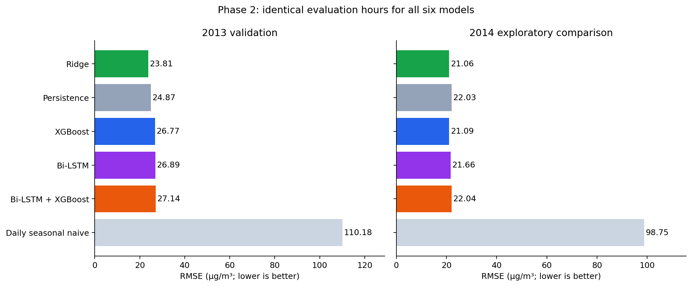

# Phase 2: audited Bi-LSTM and hybrid forecasting

> This document preserves the first corrected shared-base baseline. The completed independent-model continuation, selected results and submission are in [phase2_research.md](phase2_research.md).

The November 2026 audit found Phase 2 source code, but no saved Phase 2 models or measured Phase 2 results. The earlier README completion claim was unsupported by the available artifacts. The corrected experiment has now been trained on the real Beijing archive, with separate results in `artifacts/phase2/` and compact measured outputs in [results/phase2](results/phase2/).

## Audit findings and corrections

| Finding | Consequence | Correction |
|---|---|---|
| Neural feature means and standard deviations were calculated over the full input, including evaluation periods. | Future feature distributions influenced training. | Fit all learned preprocessing on the union of actual base-training windows only. |
| Missing inputs were filled from each prediction batch's own medians. | A forecast could change when unrelated future rows were added. | Save training medians and reuse them for every prediction. |
| An empty or invalid training mask could fall back to other nonmissing labels. | A caller's time boundary could be ignored. | Validate shape, boolean type and index alignment; reject empty training sets. |
| Wind direction was silently dropped by numeric-only conversion. | The sequence model lost an available weather feature. | Fit categorical levels on training inputs and freeze the encoded feature schema. |
| Neural random initialization and shuffled batches were not seeded. | Runs were not repeatable in the same environment. | Seed model initialization and the DataLoader generator; save settings and versions. |
| The correction head learned errors on the same rows used to fit its base. | Residuals did not represent the base's performance on later unseen hours. | Reserve the final 20% of eligible training origins for chronological calibration. Freeze the base before that period. |
| Residual inference errors were caught broadly and replaced with zero corrections. | A broken hybrid could appear to work. | Propagate errors and validate correction dimensions and finiteness. |
| Training overwrote Phase 1 metric files without saving Phase 2 prediction tables or a run manifest. | The experiment could not be independently reconstructed. | Use a new run directory, timestamped predictions, fold audits, version/source/data hashes and model hashes. Reject nonempty output directories. |
| Package imports eagerly loaded PyTorch before classical model setup, and CLI inference lacked the launcher CPU policy. | Loading a hybrid could crash on this Mac without thread flags. | Load optional neural exports lazily, initialize CPU defaults before numerical libraries, and test the CLI in a clean subprocess. |
| The CLI supplied only the latest feature row to sequence models. | There was no complete sequence to predict from. | Share sequence-aware prediction between CLI and dashboard. |
| The dashboard kept only 169 raw hours and hardcoded four comparison rows. | Early steps in the final neural window lacked their full lag history; Phase 2 scores stayed hidden. | Keep 192 raw hours when the 24-step models are loaded; display all available models and their measured errors. |

Training-only preprocessing follows the [scikit-learn guidance on data leakage](https://scikit-learn.org/stable/common_pitfalls.html#data-leakage). Seeds support repeatability within a fixed environment; they do not establish identical results across hardware or library releases, as explained in the [PyTorch reproducibility notes](https://docs.pytorch.org/docs/2.15/notes/randomness.html).

## Experiment and architecture

The forecast target remains observed PM2.5 one hour after the forecast origin. Features, hourly grid, coverage rules and quarterly splits match Phase 1. All six models use 8,563 common validation hours in 2013 and 8,531 common evaluation hours in 2014. Classical predictions are reused from the recorded Phase 1 experiment, with dataset/configuration checks and exact alignment of origins, targets, actual values and fold names. Their original files and models are preserved.

The neural model processes 24 hourly rows of the existing engineered features. The fixed configuration uses one bidirectional LSTM layer with 32 hidden units per direction, additive temporal attention, a dense regression head, dropout 0.1, six epochs, batch size 128 and AdamW learning rate 0.001. Numeric inputs and targets are standardized using base-training statistics. Wind categories are learned from those same training inputs. Concentration predictions are clipped at zero. The backward direction reads only inside the already observed 24-hour input window; it never reads beyond the forecast origin.

Within each outer training fold, the last 20% of eligible origins form the correction-calibration block. The Bi-LSTM uses earlier origins whose target labels are available by the first calibration origin. The XGBoost correction head learns `actual - base_prediction` on that later block. The base stays frozen during calibration and deployment fitting. This reserves less data for fitting the base, but makes the correction targets out of sample in time. The standalone Bi-LSTM result is this same frozen base, making the incremental effect of the correction explicit.

The correction head uses 100 trees, depth 3, learning rate 0.05, minimum child weight 5, row/column subsampling 0.8, L2 regularization 5 and one worker. Settings are recorded before scoring. There is one fixed candidate, with no holdout-based tuning or early stopping. `selection.json` records the model preferred by pooled 2013 validation RMSE before the 2014 comparison runs; Ridge is preferred in this experiment.

**The 2014 comparison is exploratory.** Its Phase 1 results had already been inspected before this work. The chronological fits avoid training on future observations, but 2014 is no longer a fresh blind evaluation for research decisions. Neither a clean holdout claim nor statistical significance is inferred from this run.

## Measured results

MAE and RMSE are in µg/m³. Every row below uses the same 8,531 observed 2014 target hours.

| Model | MAE | RMSE | R² |
|---|---:|---:|---:|
| Ridge | 11.825 | **21.063** | **0.9490** |
| XGBoost | 11.833 | 21.088 | 0.9489 |
| Bi-LSTM | 12.697 | 21.655 | 0.9461 |
| Persistence | 11.926 | 22.033 | 0.9442 |
| Bi-LSTM + XGBoost correction | 12.805 | 22.038 | 0.9442 |
| Daily seasonal naive | 67.296 | 98.754 | −0.1205 |

Bi-LSTM reduces pooled RMSE relative to persistence, but its MAE is worse. Ridge remains better on both measures. The hybrid does not improve on its neural base overall. Its correction improves base RMSE in Q3 and Q4 but worsens Q1 and Q2. Bi-LSTM has the lowest Q2 RMSE among the six models (20.049).

The correction behaves differently across pollution regimes. Below the training-only 90th-percentile threshold of 218 µg/m³, it lowers neural RMSE from 18.327 to 17.915. At or above that threshold, it increases RMSE from 40.599 to 44.107 across 865 hours. This measured peak-error deterioration explains why the correction's improvement on lower-pollution hours does not translate into a better pooled result. The experiment does not establish the underlying cause of this failure.

On 2013 validation, pooled RMSE is 23.809 for Ridge, 24.870 for persistence, 26.772 for XGBoost, 26.892 for Bi-LSTM and 27.141 for the hybrid. These scores do not support promoting either Phase 2 model over the classical comparators.



Further figures: [quarterly RMSE](results/phase2/quarterly_rmse.png), [pollution regimes](results/phase2/pollution_regimes.png), [last-week forecasts](results/phase2/forecast_last_week.png), [training losses](results/phase2/training_losses.png). Each also has a standalone PDF beside it.

## Reproduce and use the models

From the repository root, create/activate a Python 3.13 virtual environment and install the recorded environment:

```bash
python3 -m venv .venv
source .venv/bin/activate
python -m pip install -r requirements-phase2.txt
# macOS: XGBoost also requires the OpenMP runtime.
brew install libomp

python scripts/train_phase2_hybrid.py --output artifacts/phase2-new-run
python scripts/build_phase2_report.py --run artifacts/phase2-new-run --output artifacts/phase2-new-run/report
pytest -q -W error::DeprecationWarning
```

The real raw CSV and completed Phase 1 comparison files must be present. Training refuses to overwrite an existing run. The app's default Phase 2 location is `artifacts/phase2/`; alternate experiment directories are for independent runs and are not loaded automatically.

The completed local run saves `bilstm.joblib`, `hybrid.joblib`, `predictions.csv`, `neural_predictions.csv`, pooled/quarterly/regime metrics, `protocol.json`, `selection.json`, `fold_audit.json`, `run_manifest.json` and `RESULTS.md`. The model artifacts include the feature order, fit boundary, required history and calibration audit. The manifest also records hashes of the classical comparison predictions and each Phase 2 model. The larger artifacts are ignored by Git; compact measured outputs and report figures live in `docs/results/phase2/`.

Start the local dashboard with `bash scripts/start_frontend.sh`. It loads both Phase 2 models when their completed real-data manifest and matching hashes are available and PyTorch is installed. The forecast selector, pooled comparison and quarterly comparison include them. History requirements are 169 hours for the classical models alone and 192 hours when the 24-step sequence models are loaded: `168 feature-warmup hours + 24 sequence rows`.

The existing Vercel bundle remains the classical inference app; it does not package PyTorch or the new Phase 2 artifacts. The Phase 1 paper and presentation also retain their original classical results. Publication/deployment and a Phase 2 academic report are separate work.

## Verification and further research

The verified suite has 95 passing tests. The new checks cover future-feature/label perturbations, frozen imputation, exact training-mask boundaries, hourly gaps, multi-hour calibration label availability, serialization/schema stability, correction failures, common-hour comparisons, artifact hashes and manual/history forecast parity between the CLI and dashboard.

Further model development should use 2013 validation, record all candidates, and keep the already-viewed 2014 comparisons exploratory. Useful experiments include residual-head regularization, neural sequence length, unidirectional versus bidirectional recurrent models, and an explicit attention ablation. A fresh dataset or later untouched period is needed for new blind accuracy claims. This run is a measured Phase 2 baseline, not evidence that adding a neural network or a hybrid improves every metric.
