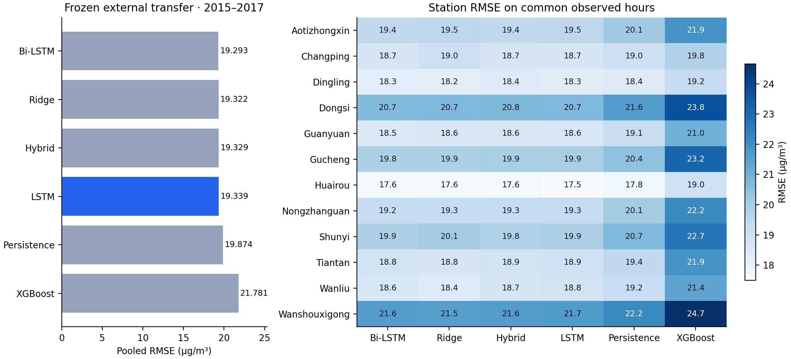

# Frozen external transfer evaluation

This supplement evaluates the previously selected models on all 12 stations in [UCI Beijing Multi-Site Air Quality](https://archive.ics.uci.edu/dataset/501/beijing+multi+site+air+quality+data) (DOI [10.24432/C5RK5G](https://doi.org/10.24432/C5RK5G), CC BY 4.0). Targets run from 1 January 2015 through 28 February 2017. The declared model copies, feature mapping, station set and scoring policy were frozen before the archive was downloaded. No model, imputer, encoder, hyperparameter, correction weight or seed was fitted or selected on these observations.

## Transfer conditions

These are different monitoring sites with weather from nearby meteorological stations. `PM2.5`, `TEMP`, `DEWP`, `PRES` and compass `wd` are mapped directly. `WSPM` measures instantaneous wind speed and cannot replace the accumulated `Iws` input; `RAIN` is precipitation amount and cannot replace rain duration `Ir`. `Iws`, `Ir` and `Is` therefore remain missing, using the existing fitted handling. Unseen wind categories retain their labels and follow the fitted unknown-category path. The fraction outside the original wind vocabulary ranges from 69.7% to 77.9% across stations.

This is external station and feature transfer evidence. It does not establish blind accuracy at the original station or present-day performance. The five-page main paper retains the original historical study; this is a separately declared supplement.

## Results

Every method is scored on the same **217,156 station-hours**, requiring observed next-hour targets, current PM2.5 and daily seasonal baseline values. Missing scoring labels are excluded. Features and sequence windows keep the complete hourly grid. Errors are in µg/m³; bias is prediction minus observation.

| Model | MAE | RMSE | R² | Bias |
|---|---:|---:|---:|---:|
| Bi-LSTM | 10.375 | 19.293 | 0.9463 | 1.943 |
| Ridge | 10.677 | 19.322 | 0.9462 | 1.646 |
| Hybrid | 10.540 | 19.329 | 0.9461 | 1.163 |
| LSTM | 10.368 | 19.339 | 0.9461 | 1.719 |
| Persistence | 10.203 | 19.874 | 0.9431 | -0.077 |
| XGBoost | 11.907 | 21.781 | 0.9316 | -5.270 |
| Daily seasonal naive | 57.053 | 89.234 | -0.1478 | -0.176 |

The original validation preference remains LSTM. Its external RMSE is 19.339, versus 19.874 for persistence. The lowest observed pooled RMSE is 19.293 for Bi-LSTM; this table does not trigger model reselection. Persistence has the lowest pooled MAE, 10.203, so the RMSE ranking does not imply improvement on every error measure. LSTM station-macro RMSE is 19.314 with station SD 1.124. Station SD describes geographical variation, not an uncertainty interval or a statistical-significance test. Pooled scores weight observed station-hours; macro scores weight stations equally.



The chart omits daily seasonal naive to keep the six stronger methods legible; its measured score remains in the table and machine-readable evidence. High-pollution analysis uses the original training-only threshold of 218 µg/m³. [Year](results/phase2_external/year_metrics.csv), [pollution regime](results/phase2_external/regime_metrics.csv), [station](results/phase2_external/station_metrics.csv) and [macro](results/phase2_external/macro_metrics.csv) tables retain the detailed comparisons.

| Station | Common target hours |
|---|---:|
| Aotizhongxin | 18,032 |
| Changping | 18,059 |
| Dingling | 18,084 |
| Dongsi | 17,900 |
| Guanyuan | 18,261 |
| Gucheng | 18,184 |
| Huairou | 18,154 |
| Nongzhanguan | 18,074 |
| Shunyi | 17,908 |
| Tiantan | 18,230 |
| Wanliu | 18,320 |
| Wanshouxigong | 17,950 |

## Provenance and reproduction

The [frozen protocol](results/phase2_external/protocol.json) records exact model bytes and both training and runtime source hashes. The reference copies were taken from the first published research run. The runtime differs only in lossless loading of the historical baseline comparison CSV; model inference and fitted parameters are unchanged. These exact reference copies remain in the runnable ZIP under `artifacts/phase2_external/reference_models/` even after the portability rerun updates the active research bundle. [Portability verification](results/phase2_research/portability_verification.json) confirms exact equality of the newly trained neural tensors, preprocessing, target statistics, hybrid tree bytes and saved forecasts. Reproduce that comparison with `python scripts/verify_phase2_portability.py`.

The [dataset provenance](results/phase2_external/dataset_provenance.json) records the official URL, download time and archive hash. The [completed manifest](results/phase2_external/run_manifest.json) links the protocol, evaluator, archive and model hashes. The full predictions and frozen reference weights are included in the runnable release; no new labels are committed into the source repository.

```bash
python scripts/validate_phase2_external.py --output artifacts/phase2-external-new --plan-only
python scripts/validate_phase2_external.py --output artifacts/phase2-external-new --resume
python scripts/build_phase2_external_report.py
```

The final report builder independently recomputes pooled and station scores, checks common targets, timestamps, hashes and the pre-download declaration. It summarizes the canonical `artifacts/phase2_external/` run; preserve that completed directory and choose a new output for another evaluation. Repeating this now is reproduction, not another untouched external test. No transfer result establishes a causal weather effect or universal architectural superiority.
